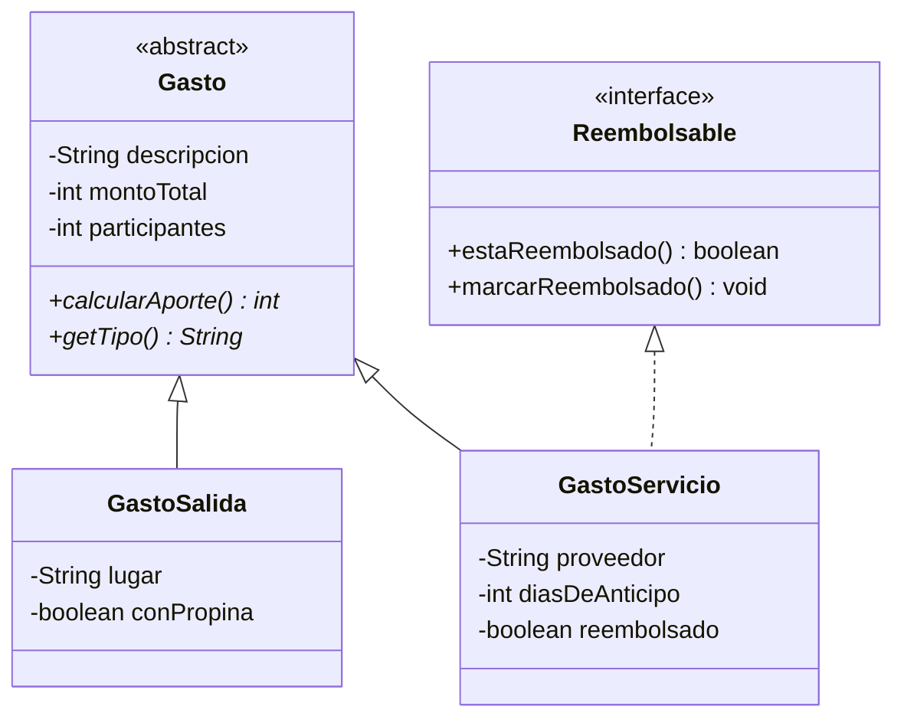

# Enunciado · Cuentas del Departamento Los Aromos

## Condiciones del ejercicio

**Del entorno y la entrega**

- El ejercicio es de carácter individual.
- El programa debe compilar y ejecutarse correctamente. Una solución que no compile no permite evidenciar ningún indicador de logro.
- La entrega se realiza según las instrucciones de quien dicta el ejercicio.

**De tu solución**

- El código debe organizarse en clases separadas, respetando las convenciones de nomenclatura de Java: PascalCase para nombres de clase, camelCase para métodos y atributos.
- Puedes crear métodos o clases auxiliares siempre que no contradigan los requerimientos del caso.
- Para que la práctica sirva, resuélvelo sin ayuda de herramientas de inteligencia artificial ni de soluciones ya hechas.

---

## 1. Contexto del caso

Los residentes del departamento Los Aromos comparten los gastos de la casa: las cuentas de los servicios y las salidas que hacen en grupo. Ya cuentan con el modelo de clases desarrollado en una etapa anterior: el sistema distingue salidas grupales y cuentas de servicios, calcula cuánto debe aportar cada participante según el tipo de gasto y permite marcar las cuentas de servicios que ya fueron reembolsadas a quien adelantó el pago. Sin embargo, ese sistema solo funciona por consola y la información se pierde cada vez que el programa se cierra.

Los residentes han solicitado transformarlo en una aplicación de escritorio con ventanas, que permita registrar y eliminar gastos, y que conserve la información en archivos para que esté disponible la próxima vez que se abra la aplicación.

### Proyecto base

El proyecto base es un proyecto Maven con la configuración inicial, la clase de arranque y el modelo ya implementado y probado, correspondiente al diagrama siguiente. Tu trabajo consiste en construir sobre ese modelo la interfaz gráfica y el almacenamiento en archivos. No debes reescribir ni reemplazar las clases entregadas.

El modelo entregado ya aplica las siguientes reglas. En ambos tipos, el aporte base de cada participante es el monto total dividido entre los participantes (división entera, en pesos):

- Salida: si se dejó propina, el aporte base se incrementa en un 10%.
- Servicio: si la cuenta se pagó con 10 días o más de anticipación, el aporte base se reduce en un 8%.

Datos comunes: la descripción del gasto no puede ser nula ni vacía, el monto total debe estar entre $1.000 y $5.000.000 y los participantes deben estar entre 1 y 20. Si un dato no cumple, el modelo lo rechaza con un mensaje que explica el motivo.

## 2. Estructura del proyecto

La solución debe separar responsabilidades según el patrón Modelo-Vista-Controlador, con una capa de acceso a datos basada en el patrón DAO/Repository. No hay una única forma de resolverlo: lo importante es que se cumplan los siguientes puntos.

- **Configuración del proyecto:** el proyecto base ya incluye las dependencias de JavaFX y la clase de arranque de la aplicación. Debes agregar al archivo `pom.xml` la dependencia de la librería Gson, necesaria para trabajar con archivos JSON, sin alterar lo que ya existe.
- **Vista:** la ventana se declara en un archivo FXML (por ejemplo, diseñado con Scene Builder) y se carga desde la clase de arranque. No se acepta una interfaz construida solo por código.
- **Vista y controlador:** el FXML indica su clase controladora, y cada componente que usa el controlador lleva `fx:id` en la vista y un atributo con el mismo nombre y tipo en el controlador, con la anotación `@FXML`.
- **Paquetes:** las clases se separan en paquetes distintos para controlador, modelo y persistencia, y el FXML va en los recursos. El modelo y la persistencia no dependen del controlador ni de clases de JavaFX. Las clases nuevas no van en el paquete raíz ni dentro del paquete del modelo.
- **Controlador:** valida las entradas y coordina la interfaz. Los cálculos y reglas del negocio (como el aporte por persona) los entrega el modelo, y las operaciones con los datos se piden al Repository. No lee ni escribe archivos directamente.
- **Persistencia (DAO/Repository):** una interfaz DAO con las operaciones de lectura y escritura; una implementación del DAO con Gson que maneje los archivos; y una clase Repository que mantenga los gastos en memoria, ofrezca las operaciones que usa el controlador y delegue en el DAO la lectura y escritura de archivos.

## 3. Ventana de la aplicación

Al ejecutar la aplicación se abre una única ventana, desde la cual se realizan todas las acciones. La ventana debe contener:

- Un formulario de registro con los campos descritos más abajo y un botón Registrar.
- Una tabla con los gastos registrados y las columnas Tipo, Descripción, Monto total, Participantes y Aporte por persona. El aporte que se muestra es el que calcula el modelo para cada gasto.
  La tabla usa como fuente de datos una única lista observable, que se mantiene durante toda la ejecución y se actualiza al iniciar y tras cada registro o eliminación (no se crea una lista nueva cada vez). Debe mostrar salidas y servicios sin duplicar ninguno.
- Un botón Eliminar, que quita del registro el gasto seleccionado en la tabla. Si no hay una fila seleccionada, la aplicación informa que se debe seleccionar un gasto y no realiza ningún cambio.
- Un área de mensajes dentro de la misma ventana, donde se informa el resultado de cada acción: registro exitoso, dato no válido, eliminación, falta de selección o error al leer o guardar los archivos. Cada mensaje identifica el gasto o la causa, y reemplaza al anterior. Los mensajes no se muestran por consola.

**Campos del formulario**

- Un selector de tipo con las opciones Salida y Servicio.
- Datos comunes: descripción, monto total y participantes.
- Datos de la salida: lugar y si se dejó propina (sí/no).
- Datos del servicio: proveedor, días de anticipo con que se pagó la cuenta y si ya fue reembolsado (sí/no).

Al cambiar el tipo en el selector, solo quedan habilitados los datos específicos del tipo elegido; los datos del otro tipo quedan deshabilitados y no se consideran al registrar.

Al presionar Registrar, la aplicación valida los datos según la sección 4. Si son correctos, registra el gasto, la tabla lo muestra de inmediato, el área de mensajes informa la confirmación (por ejemplo: “Entradas al cine (Salida) registrado correctamente.”) y el formulario queda vacío para un nuevo registro.

## 4. Validaciones del formulario

Antes de registrar, el formulario debe verificar los datos ingresados según las siguientes reglas:

- Tipo: debe estar seleccionado.
- Descripción: no puede estar vacía ni contener solo espacios.
- Monto total: número entero entre 1.000 y 5.000.000 (pesos).
- Participantes: número entero entre 1 y 20.
- Lugar (solo salida): no puede estar vacío ni contener solo espacios.
- Proveedor (solo servicio): no puede estar vacío ni contener solo espacios.
- Días de anticipo (solo servicio): número entero entre 0 y 60.

Las reglas de descripción, monto y participantes son las mismas que ya aplica el modelo entregado. Si algún dato no es válido:

- el gasto no se registra;
- el área de mensajes indica qué campo es incorrecto y por qué;
- los valores ya ingresados se mantienen para que puedan corregirse;
- la aplicación no se detiene ni muestra errores por consola.

## 5. Almacenamiento de la información

La información de los gastos debe conservarse entre una ejecución y otra, en formato JSON, en la carpeta raíz del proyecto:

- `salidas.json`: contiene las salidas registradas.
- `servicios.json`: contiene los servicios registrados.

El comportamiento esperado es el siguiente:

- Al iniciar, la aplicación carga automáticamente la información de ambos archivos y la muestra en la tabla.
- Si los archivos no existen (por ejemplo, la primera vez que se ejecuta), la aplicación inicia con la tabla vacía y sin mostrar errores.
- Cada vez que se registra o se elimina un gasto, los archivos se actualizan automáticamente, sin que el usuario deba presionar un botón para guardar.
- Lo que muestra la tabla y lo guardado en los archivos debe coincidir en todo momento.
- Si no se puede leer o guardar un archivo, el área de mensajes lo informa en la misma ventana. Si falla un guardado, no se informa éxito y el cambio no se aplica, de modo que la tabla y los archivos siguen coincidiendo.

## 6. Datos de prueba y resultado esperado

Registra desde la aplicación los siguientes gastos:

| Tipo | Descripción | Monto total | Participantes | Datos específicos | Aporte por persona |
|---|---|---|---|---|---|
| Salida | Cena de cumpleaños | 120000 | 4 | Lugar: Restaurante El Fogón \| Propina: sí | $33.000 |
| Salida | Entradas al cine | 36000 | 3 | Lugar: Cine Plaza \| Propina: no | $12.000 |
| Servicio | Internet del departamento | 60000 | 4 | Proveedor: FibraSur \| Días de anticipo: 12 \| Reembolsado: sí | $13.800 |
| Servicio | Cuenta de la luz | 90000 | 3 | Proveedor: Luz Central \| Días de anticipo: 3 \| Reembolsado: no | $30.000 |

Luego de registrarlos, la ventana debe mostrar los cuatro gastos con sus aportes. Si se presiona Eliminar sin seleccionar una fila, el aviso aparece en la misma ventana.

Si un dato del formulario no es válido (por ejemplo, un monto `abc` o unos participantes `0`), el área de mensajes indica el campo con problemas y se mantienen los valores ingresados.

**Verificación de almacenamiento**

- Cierra la aplicación y vuelve a abrirla: la tabla debe mostrar los mismos cuatro gastos, y el servicio de Internet debe seguir como reembolsado (se comprueba en `servicios.json`).
- Elimina las entradas al cine, cierra la aplicación y vuelve a abrirla: ese gasto ya no debe aparecer.
