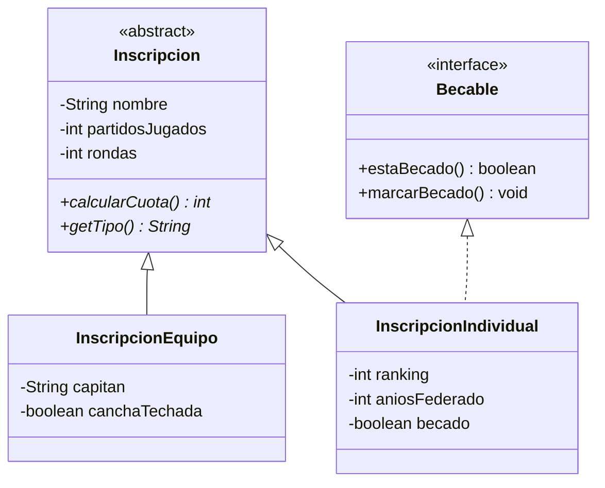

# Enunciado · Torneo Copa Austral

## Condiciones del ejercicio

**Del entorno y la entrega**

- El ejercicio es de carácter individual.
- El programa debe compilar y ejecutarse correctamente. Una solución que no compile no permite evidenciar ningún indicador de logro.
- La entrega se hace según las instrucciones de quien dicta el ejercicio.

**De tu solución**

- El código debe organizarse en clases separadas, respetando las convenciones de nomenclatura de Java: PascalCase para nombres de clase, camelCase para métodos y atributos.
- Puedes crear métodos o clases auxiliares siempre que no contradigan los requerimientos del caso.
- Para que la práctica sirva, resuélvelo sin ayuda de herramientas de inteligencia artificial ni de soluciones ya hechas.

---

## 1. Contexto del caso

El torneo Copa Austral, un campeonato deportivo de verano, ya cuenta con el modelo de clases desarrollado en una etapa anterior: el sistema distingue las inscripciones de equipos y las de competidores individuales, calcula la cuota de inscripción de cada una según su tipo y permite marcar como becadas las inscripciones individuales. Sin embargo, ese sistema solo funciona por consola y la información se pierde cada vez que el programa se cierra.

La organización del torneo ha solicitado transformarlo en una aplicación de escritorio con ventanas, que permita a la secretaría registrar y eliminar inscripciones, y que conserve la información en archivos para que esté disponible la próxima vez que se abra la aplicación.

### Proyecto base

El proyecto base es un proyecto Maven con la configuración inicial, la clase de arranque y el modelo ya implementado y probado, correspondiente al diagrama siguiente. Tu trabajo consiste en construir sobre ese modelo la interfaz gráfica y el almacenamiento en archivos. No debes reescribir ni reemplazar las clases entregadas.

El modelo entregado ya aplica las siguientes reglas:

- Inscripción de equipo: cuota base de $60.000. Si el equipo pide cancha techada, la cuota se incrementa en un 25%.
- Inscripción individual: cuota base de $18.000. Si el competidor lleva más de 3 años federado, la cuota se reduce en un 20%.

Datos comunes: el nombre no puede ser nulo ni vacío, los partidos jugados (en torneos anteriores) deben estar entre 0 y 200 y las rondas en las que participará la inscripción deben estar entre 1 y 12. Si un dato no cumple, el modelo lo rechaza con un mensaje que explica el motivo.

## 2. Estructura del proyecto

La solución debe separar responsabilidades según el patrón Modelo-Vista-Controlador, con una capa de acceso a datos basada en el patrón DAO/Repository. No hay una única forma de resolverlo: lo importante es que se cumplan los siguientes puntos.

- **Configuración del proyecto:** el proyecto base ya incluye las dependencias de JavaFX y la clase de arranque de la aplicación. Debes agregar al archivo `pom.xml` la dependencia de la librería Gson, necesaria para trabajar con archivos JSON, sin alterar lo que ya existe.
- **Vista:** la ventana se declara en un archivo FXML (por ejemplo, diseñado con Scene Builder) y se carga desde la clase de arranque. No se acepta una interfaz construida solo por código.
- **Vista y controlador:** el FXML indica su clase controladora, y cada componente que usa el controlador lleva `fx:id` en la vista y un atributo con el mismo nombre y tipo en el controlador, con la anotación `@FXML`.
- **Paquetes:** las clases se separan en paquetes distintos para controlador, modelo y persistencia, y el FXML va en los recursos. El modelo y la persistencia no dependen del controlador ni de clases de JavaFX. Las clases nuevas no van en el paquete raíz ni dentro del paquete del modelo.
- **Controlador:** valida las entradas y coordina la interfaz. Los cálculos y reglas del negocio (como la cuota) los entrega el modelo, y las operaciones con los datos se piden al Repository. No lee ni escribe archivos directamente.
- **Persistencia (DAO/Repository):** una interfaz DAO con las operaciones de lectura y escritura; una implementación del DAO con Gson que maneje los archivos; y una clase Repository que mantenga las inscripciones en memoria, ofrezca las operaciones que usa el controlador y delegue en el DAO la lectura y escritura de archivos.

## 3. Ventana de la aplicación

Al ejecutar la aplicación se abre una única ventana, desde la cual se realizan todas las acciones. La ventana debe contener:

- Un formulario de registro con los campos descritos más abajo y un botón Registrar.
- Una tabla con las inscripciones registradas y las columnas Tipo, Nombre, Partidos jugados, Rondas y Cuota de inscripción. La cuota que se muestra es la que calcula el modelo para cada inscripción.
  La tabla usa como fuente de datos una única lista observable, que se mantiene durante toda la ejecución y se actualiza al iniciar y tras cada registro o eliminación (no se crea una lista nueva cada vez). Debe mostrar equipos e individuales sin duplicar ninguno.
- Un botón Eliminar, que quita del registro la inscripción seleccionada en la tabla. Si no hay una fila seleccionada, la aplicación informa que se debe seleccionar una inscripción y no realiza ningún cambio.
- Un área de mensajes dentro de la misma ventana, donde se informa el resultado de cada acción: registro exitoso, dato no válido, eliminación, falta de selección o error al leer o guardar los archivos. Cada mensaje identifica la inscripción o la causa, y reemplaza al anterior. Los mensajes no se muestran por consola.

**Campos del formulario**

- Un selector de tipo con las opciones Equipo e Individual.
- Datos comunes: nombre, partidos jugados y rondas.
- Datos del equipo: capitán y si pide cancha techada (sí/no).
- Datos del competidor individual: ranking, años federado y si cuenta con beca (sí/no).

Al cambiar el tipo en el selector, solo quedan habilitados los datos específicos del tipo elegido; los datos del otro tipo quedan deshabilitados y no se consideran al registrar.

Al presionar Registrar, la aplicación valida los datos según la sección 4. Si son correctos, registra la inscripción, la tabla la muestra de inmediato, el área de mensajes informa la confirmación (por ejemplo: “Inscripción de Pumas del Sur (Equipo) registrada correctamente.”) y el formulario queda vacío para un nuevo registro.

## 4. Validaciones del formulario

Antes de registrar, el formulario debe verificar los datos ingresados según las siguientes reglas:

- Tipo: debe estar seleccionado.
- Nombre: no puede estar vacío ni contener solo espacios.
- Partidos jugados: número entero entre 0 y 200.
- Rondas: número entero entre 1 y 12.
- Capitán (solo equipo): no puede estar vacío ni contener solo espacios.
- Ranking (solo individual): número entero entre 1 y 500.
- Años federado (solo individual): número entero entre 0 y 40.

Las reglas de nombre, partidos jugados y rondas son las mismas que ya aplica el modelo entregado. Si algún dato no es válido:

- la inscripción no se registra;
- el área de mensajes indica qué campo es incorrecto y por qué;
- los valores ya ingresados se mantienen para que puedan corregirse;
- la aplicación no se detiene ni muestra errores por consola.

## 5. Almacenamiento de la información

La información de las inscripciones debe conservarse entre una ejecución y otra, en formato JSON, en la carpeta raíz del proyecto:

- `equipos.json`: contiene las inscripciones de equipos.
- `individuales.json`: contiene las inscripciones individuales.

El comportamiento esperado es el siguiente:

- Al iniciar, la aplicación carga automáticamente la información de ambos archivos y la muestra en la tabla.
- Si los archivos no existen (por ejemplo, la primera vez que se ejecuta), la aplicación inicia con la tabla vacía y sin mostrar errores.
- Cada vez que se registra o se elimina una inscripción, los archivos se actualizan automáticamente, sin que el usuario deba presionar un botón para guardar.
- Lo que muestra la tabla y lo guardado en los archivos debe coincidir en todo momento.
- Si no se puede leer o guardar un archivo, el área de mensajes lo informa, indicando el archivo afectado. Si falla un guardado, no se informa éxito y el cambio no se aplica, de modo que la tabla y los archivos siguen coincidiendo.

## 6. Datos de prueba y resultado esperado

Registra desde la aplicación las siguientes inscripciones:

| Tipo | Nombre | Partidos jugados | Rondas | Datos específicos | Cuota de inscripción |
|---|---|---|---|---|---|
| Equipo | Halcones FC | 48 | 6 | Capitán: R. Pizarro \| Cancha techada: sí | $75.000 |
| Equipo | Tigres Norte | 30 | 4 | Capitán: L. Araya \| Cancha techada: no | $60.000 |
| Individual | Camila Soto | 22 | 3 | Ranking: 14 \| Años federado: 5 \| Beca: no | $14.400 |
| Individual | Mateo Rojas | 7 | 2 | Ranking: 120 \| Años federado: 2 \| Beca: sí | $18.000 |

Luego de registrarlas, la ventana debe mostrar las cuatro inscripciones con sus cuotas. Si se presiona Eliminar sin seleccionar una fila, el aviso aparece en la misma ventana.

Si un dato del formulario no es válido (por ejemplo, unos partidos jugados `abc` o unas rondas `0`), el área de mensajes indica el campo con problemas y se mantienen los valores ingresados.

**Verificación de almacenamiento**

- Cierra la aplicación y vuelve a abrirla: la tabla debe mostrar las mismas cuatro inscripciones, y Mateo Rojas debe seguir con beca (se comprueba en `individuales.json`, donde su campo `becado` vale `true`).
- Elimina Tigres Norte, cierra la aplicación y vuelve a abrirla: Tigres Norte ya no debe aparecer.
